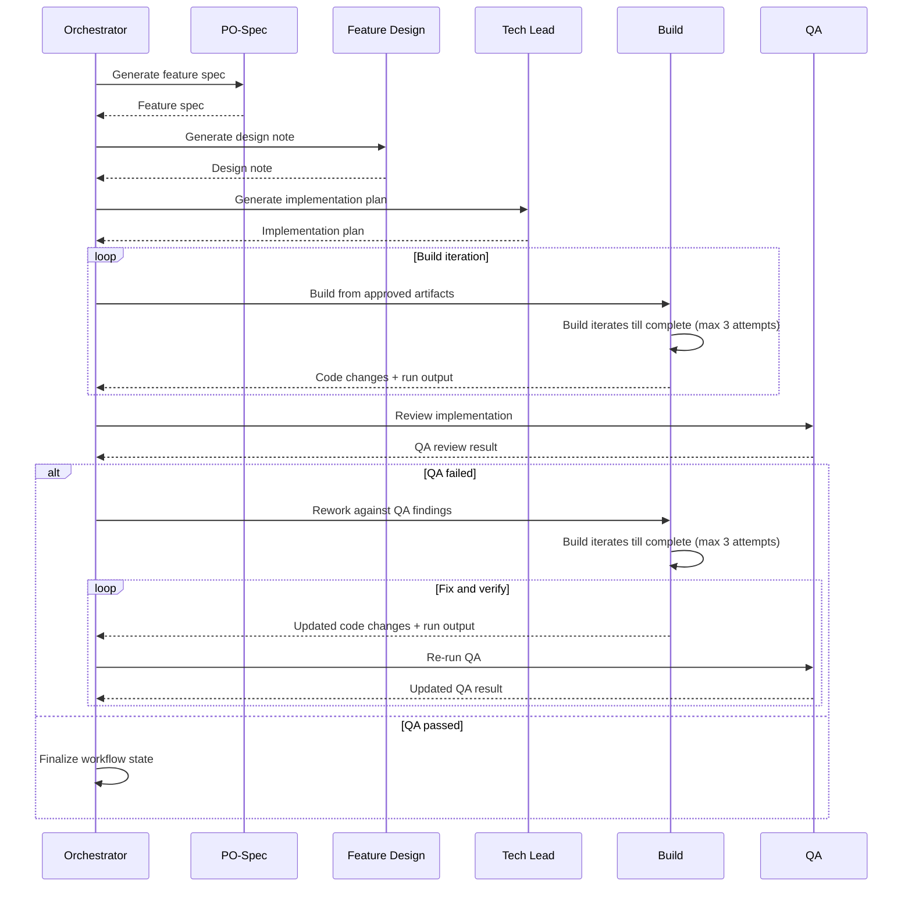

Carrying on from my recent post giving an <a href="/blog/an-introduction-to-harness-engineering" target="_blank" rel="nofollow">Introduction to Harness Engineering</a>, I want to start to dig a level deeper on the topics involved. First up we're going to look at the **Agents** and **Roles** that are defined in a setup like this. They're one of the key elements in Harness Engineering and are what actually control and execute the work you want completed, so they're a good place to get started!

## Agents and Roles
A lot of AI workflow discussion seems to treat agents and roles as one, but I found that separating them makes the system easier to design, understand, and to iteratively improve on. In the setup I created, I ended up with a 1-1 relationship between my **Agents** and **Roles**, so you might be wondering why they are separated and not just combined together. Well there are some distinct benefits to defining them separately.

Keeping them separate allowed me to have the Agents be responsible for defining the tools it has access to, but its actual tasks are defined in the role itself. So if we take the **Build Agent** for example it's definition is quite skinny, it defines the tools it has access to, the areas of the codebase it can access, and also what areas it shouldn't.

``` md
---
name: build
description: Implement the active task defined in harness/run-state.md using the approved specification, design note, and implementation plan.
tools:
  - edit/editFiles
  - search/codebase
  - search
  - execute/runInTerminal
  - read/terminalLastCommand
---

Follow the role definition in:
- `harness/roles/build-agent.md`

Follow these standards and references:
- `harness/standards/coding-standard.md`
- `harness/standards/testing-standard.md`
- `harness/standards/feature-workflow.md`
- `harness/standards/task-lifecycle.md`
- `harness/standards/run-id-standard.md`

Use this template:
- `harness/templates/run_report_template.md`

Read the live execution state in:
- `harness/run-state.md`

Use the task file referenced there as the only task for this run.

Read the approved artifacts referenced by the task file and/or run-state before making changes:
- feature specification
- design note
- implementation plan

Generate a stage-appropriate Build run ID using the run-id standard.

Determine the canonical run report path from the task file and/or run-state.

Create or update the run report with:
- task metadata
- current stage
- current run ID
- stage history entry for the Build stage
- validation evidence
- stop or pause state if relevant
- notes relevant to QA handoff

Do not modify governance-controlled files or paths as part of normal implementation work.

Governance-controlled paths include:
- `harness/run-state.md`
- `harness/tasks/`
- `harness/backlog/`
- `harness/standards/`
- `harness/roles/`
- `harness/templates/`
- `.github/agents/`
- `.cursor/rules/`

If governance metadata appears inconsistent, report it in the implementation summary and run report instead of changing it.

Use the controlled validation loop defined by the Build role when command execution is available.

The validation loop may run only the approved commands and must stay within the retry and scope limits defined in the role.

Operate only within the approved task scope.

Make implementation changes, required test changes, and the run report update, but do not continue beyond this stage without orchestration or human review.
```

If we take a look at the **Build Role** you can see it is much more detailed, defining things like where to access the coding guidance docs, how to build and run the project, the process it should follow and also its required output alongside much more.

``` md
# Build Agent

## Purpose

The Build Agent implements the approved implementation plan by writing or modifying code within the repository.

The goal of this role is to translate the approved specification, design note, and implementation plan into working code while following the project's coding standards and testing expectations.

The Build Agent should focus on faithful execution of the approved plan, not reinterpretation of the feature or management of workflow state.

The currently active task and active run context are defined in `harness/run-state.md`.

---

## Responsibilities

This role is responsible for:
- implementing the steps defined in the implementation plan
- writing production application code
- adding or updating tests where required
- following project coding standards
- keeping changes within the approved task scope
- documenting assumptions made during implementation
- reporting blockers, workflow inconsistencies, or deviations clearly
- using the controlled validation loop to resolve obvious in-scope failures where allowed
- creating or updating the task run report with build-stage outcomes and validation evidence

The implementation should align with the approved feature specification and design note.

---

## Non-Responsibilities

This role must not:
- modify the feature specification
- redesign the feature layout
- introduce unrelated refactors
- expand the feature scope
- invent architectural patterns not defined in the implementation plan
- modify workflow governance files
- update lifecycle state or task-management metadata
- repair harness governance inconsistencies by editing control files
- continue fixing indefinitely without a retry boundary
- approve task completion

If the implementation plan appears incorrect or incomplete, the role should escalate rather than improvise.

If governance or lifecycle metadata appears inconsistent, the role should report it and stop, not fix it.

---

## Required Inputs

This role requires:
- the live run state
- the referenced active task file
- the approved feature specification
- the approved design note
- the approved implementation plan
- access to the repository codebase
- the run report template

This role should rely on `harness/run-state.md` as the authoritative source of active task and current run context.

---

## Required References

Before making changes, this role should review:
- `harness/run-state.md`
- `harness/roles/build-agent.md`
- `harness/standards/coding-standard.md`
- `harness/standards/testing-standard.md`
- `harness/standards/feature-workflow.md`
- `harness/standards/task-lifecycle.md`
- `harness/standards/run-id-standard.md`
- `harness/templates/run_report_template.md`

These standards and templates define expectations for implementation quality, workflow boundaries, run naming, validation loop behavior, and durable build evidence recording.

---

## Protected Files and Paths

The following paths are governance-controlled and must not be modified by this role unless the human reviewer explicitly requests a harness change:
- `harness/run-state.md`
- `harness/tasks/`
- `harness/backlog/`
- `harness/standards/`
- `harness/roles/`
- `harness/templates/`
- `.github/agents/`

This role may read these files when required, but must not edit them as part of normal feature implementation.

The Build Agent may create or update the current task run report in `harness/runs/` because the run report is an execution artifact, not the authoritative workflow-state file.

---

## Validation Loop Rules

This role may run a controlled validation loop during implementation.

### Allowed Validation Commands

When available in the runtime environment, the Build Agent may run:
- `pnpm lint`
- `pnpm typecheck`
- `pnpm test`
- `pnpm test:e2e`

These commands must be run from the application workspace (`src/`) unless project structure requires otherwise.

### Allowed Fix Scope

The Build Agent may fix:
- implementation defects introduced or revealed within the approved task scope
- test failures caused by implementation or test/config issues directly related to the active task
- configuration issues required for the approved task's tests to run correctly

The Build Agent must not use the validation loop to introduce unrelated cleanup, broad refactors, or new features.

### Retry Limit

The Build Agent may perform up to **3 validation-fix iterations** in a single build run.

A validation-fix iteration means:
1. run an allowed validation command
2. inspect the failure
3. apply a bounded fix
4. rerun validation

If validation still fails after 3 iterations, the Build Agent must stop and escalate.

### Stop Conditions

The Build Agent must stop the validation loop when:
- all required validation commands pass
- a failure implies broader scope than the approved task
- a failure suggests the implementation plan is insufficient or incorrect
- a governance inconsistency blocks reliable continuation
- the retry limit is reached

---

## Process

Follow this process when implementing a feature:
1. Read the live execution state in `harness/run-state.md`.
2. Confirm that the current stage is `Build`.
3. Use the task file referenced in `harness/run-state.md` as the single task for this run.
4. Read the approved feature specification and acceptance criteria.
5. Read the approved design note to understand the intended user experience and layout expectations.
6. Read the approved implementation plan carefully and use it as the execution boundary.
7. Generate a stage-appropriate run ID for the Build stage using the run-id standard.
8. Identify the implementation slices and execute them in small, controlled steps.
9. Modify only the application code, tests, and implementation-relevant files needed for the approved task.
9a. Implement file and folder placement exactly as defined in the task, feature specification, and implementation plan.
- If canonical paths are defined, do not introduce alternative structures.
- Do not introduce new architectural folders for organisational preference.
10. Add or update tests as defined in the implementation plan.
11. Run the allowed validation commands where the runtime environment supports command execution.
12. If validation fails, apply bounded in-scope fixes and rerun within the retry limit.
13. Create or update the task run report at the canonical run report path defined by the task file and/or run-state.
14. Record in the run report:
    - task ID
    - task title
    - current stage
    - current Build-stage run ID
    - implementation summary
    - files changed
    - validation commands executed
    - validation results observed
    - assumptions used
    - blockers or follow-up recommendations
    - governance observations, if any
15. If governance metadata appears inconsistent, report it in the run report and implementation summary instead of editing control files.
16. Prepare a concise build-stage summary for the user.
17. Do not implement custom parsers for standard content formats such as Markdown when a suitable project-compatible library can satisfy the requirement more safely and with less complexity.

---

## Output Requirements

The output of this role should include:
- a Build-stage run ID following the run-id standard
- code changes
- new or updated tests
- a summary of the implementation
- a list of modified files
- validation commands run
- validation results observed
- any assumptions made during implementation
- any known limitations, blockers, or follow-up recommendations
- confirmation that the run report was created or updated

The implementation should leave the task ready for later QA review.

If governance inconsistencies were observed, they should be reported in the summary and run report rather than corrected by this role.

If validation could not be run because the runtime environment lacked command execution, that must be stated explicitly in both the summary and the run report.

---

## Quality Bar

A successful implementation should be:
- correct
- minimal
- readable
- aligned with coding standards
- supported by appropriate tests
- bounded to the approved task scope

A successful build run should:
- implement the approved slices
- avoid unrelated refactors
- avoid changing workflow governance
- remain clearly distinct from QA and task control responsibilities
- use the validation loop responsibly and stop when blocked
- leave durable validation evidence in the run report for downstream QA

The implementation should remain simple and avoid unnecessary complexity.

---

## Escalation Conditions

Escalate when:
- `harness/run-state.md` is missing or unclear
- the current stage is not `Build`
- the referenced task file does not exist
- the approved feature specification is missing
- the approved design note is missing
- the approved implementation plan is missing
- governance files appear inconsistent with the actual stage of work
- the implementation plan conflicts with the current codebase
- required files or architecture do not exist
- the feature cannot be implemented within the defined scope
- acceptance criteria cannot be satisfied
- validation still fails after the retry limit
- the runtime environment does not support required validation commands
- the run report path is missing or cannot be determined

Escalation should clearly explain the blocker.

---

## Handoff
The output of this role becomes the input for the QA Agent, which validates that the implementation satisfies the feature specification and acceptance criteria.

This role does not update workflow state directly; the orchestrator is responsible for recording stage completion and progression.
```

Another cool advantage to separating responsibilities like this, is that it allows you to remain somewhat IDE agnostic. With the vast majority of the definition existing in the **Role** and not the **Agent**, all you need to do is replicate the skinny **Agent** format for each of the IDE's you want to support instead of having to replicate the full definition for each.

The way I like to think about this is that **Agents** are there to **Execute**, whereas Roles are there to **Govern**.

## Multi Agent Workflows
A lot of the time talking to an LLM agent directly in a chat window in an IDE will get you a good enough result eventually, but it usually becomes inconsistent once a workflow needs handoffs, traceability, and repeatable quality. You get these features by developing a harness with well bounded Agent and Role definitions, that stop scope creep & excessive Context grabbing.

I've found that the best results generally don't come from giving a single agent every bit of context possible, and maximum freedom, but from creating discrete agents each with a very narrow purpose that can execute one single part of the system well. Generally with a single **Orchestrator Agent**, whose role isn't to actually perform any of the tasks but to oversee the system as a whole.

## My Agents and Roles

As I mentioned in my previous post I ended up with the following set of Agents defined in my Harness. Each one with a corresponding Role definition used to contain the majority of the definition.

- *Orchestrator* — Controls the workflow end to end, decides which stage should run next, invokes subagents, validates handoffs, keeps execution moving in the right order, and bails out if one of the subagents fails.
- *PO-Spec* — Turns the original idea or request into a clear feature specification with scope, intent, and acceptance criteria.
- *Feature Design* — Translates the feature requirements into a design direction, interaction model, and structural approach for the features being built.
- *Tech Lead* — Converts the spec and design into an implementation plan with technical decisions, architecture guidance, and delivery steps.
- *Build* — Actually does the coding work - it carries out the implementation work by creating or updating the code and assets needed to deliver the feature.
- *QA* — Reviews the output against the specification and expected behaviour, identifies gaps or defects, and decides whether the work is ready or needs to return to Build.

The Orchestrator agent is responsible for executing the system as a whole, calling each of the subagents at the correct time, in the correct order and validating the output before moving on to the next one. You can see a Sequence Diagram below, showing the order of execution in the system.




## Artifacts, Inputs and Context
I'm going to focus more on this topic in my next post, but you can see from the diagram above that as each of the subagents executes, it is responsible for producing a specific single output, e.g. the **PO-Spec Agent** is responsible for taking the Task definition I create and generating a **Feature Specification** defining what it is the system is going to build. That is all though, the agent doesn't then make any code change or anything else, it just produces that document then stops. That document is then used as an input for the **Feature Design Agent** to be able to create the **Design Note**. Both of these documents are then used by the **Tech Lead Agent** to create a detailed **Implementation Plan**.

This is what I mean when I talk about *discrete agents with narrow responsibility*. Each of the agents has a single task, and the outputs of those tasks are used by the subsequent agents for them to complete their own tasks. This means that each agent is provided the exact amount of context it requires to get it's job done.