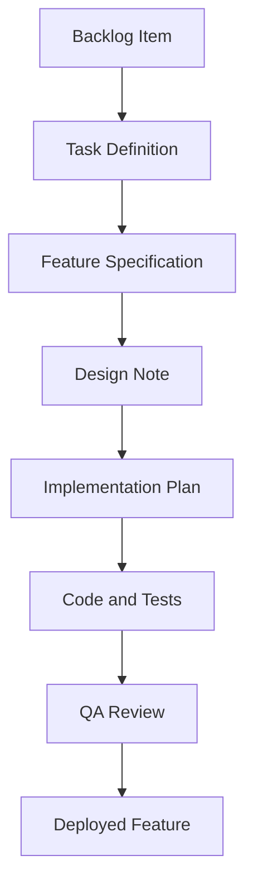
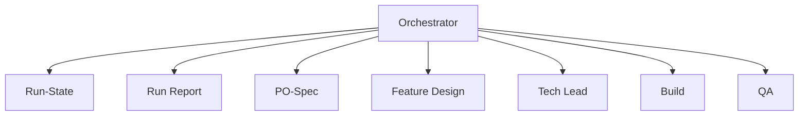

--- 

This post is part of my series deep diving into **Harness Engineering**. You can find all of the posts in the series so far below:
- <a href="/blog/an-introduction-to-harness-engineering" target="_blank" rel="nofollow">An Introduction to Harness Engineering</a>
- <a href="/blog/harness-engineering-agents-and-roles" target="_blank" rel="nofollow">Harness Engineering: Agents and Roles</a>
- <a href="/blog/harness-engineering-artifacts-inputs-and-context" target="_blank" rel="nofollow">Harness Engineering: Artifacts, Inputs and Context</a>
- <a href="/blog/harness-engineering-orchestration-and-execution-tracking" target="_blank" rel="nofollow">Harness Engineering: Orchestration and execution tracking</a>
- Harness Engineering: Running the pipeline end-to-end

---

When I finished my last blog post, I said I wanted to write this post detailing how I run the complete pipeline in the harness from end to end, so let's do that.

We're going to follow one backlog item through the pipeline to completion. I chose the backlog item where I added support for mermaid diagrams into the blog. This is a good example because it's a pretty small update, but it's got to be integrated with a lot of existing code that's already there. If you look back at the previous post on harness engineering where I covered agents and roles, you can see an example of a mermaid diagram in action, and the reason this feature was required.

## Generating the Task Definition from the Backlog

So let's start by looking at the backlog item. Below you can see the item as it was listed in my backlog file, and as you can see, it's just a simple one-liner. There's not much detail there at all. 

```
### B017 - Blog support for Mermaid Diagrams
**Status:** Done  
**Summary:** Add support for mermaid diagrams to be added into the blog post functionality for the site.
```

To prepare the pipeline for execution I need to take that backlog item and generate a task definition. I do this by talking to the LLM and asking it to generate a task definition based on the backlog item number. I go back and forth with the LLM a few times, answering some questions, and once it has all the information it needs, it goes away and generates the task definition. You can see the back and forth I had with the LLM below. 

```
Rob: 
Can you please generate the task document for backlog item B017. This Task id will be T014. Please ask me any qualifying questions you require to develop the task document. Ensure you use the task template when generating the document

---

LLM: 
Perfect! I found B017 in the backlog. Before I generate the task document for T014, I have some qualifying questions about the Mermaid diagram support feature:

Implementation Scope:
1. How should Mermaid diagrams be integrated? (e.g., as a markdown code fence syntax like ```mermaid ... ```, a custom component, or both?)
2. Should ALL Mermaid diagram types be supported, or are there specific types to prioritize? (flowcharts, sequence diagrams, class diagrams, etc.)

User Experience:
3. Should there be any styling applied to the diagrams beyond Mermaid's defaults? Should they respect the site's theme/color scheme?
4. How should invalid or malformed Mermaid code be handled? (silent fallback, error message, placeholder?)

Display & Performance:
5. Should diagrams be displayed at full width, constrained to a specific width, or responsive?
6. Are there any performance considerations or diagram size/complexity limits to document?

Documentation & Examples:
7. Should the blog post content about Mermaid diagrams include example diagrams with the feature documentation?
8. Should there be a style guide or documentation page added to the site showing supported diagram types and usage examples?

Testing Requirements:
9. What level of testing is expected? (unit tests for the rendering component, integration tests, visual regression tests?)

Please answer these questions so I can create a comprehensive and well-scoped task document.

---

Rob:
1. Yes in mermaid code fence
2. all default mermaid diagrams to be supported please
3. no styling needed for now, let's go with the defaults
4. error message please
5. Responsive please
6. I don't think so, the ones I'm creating won't be too complex
7. I'm not blogging about mermaid, the diagrams will be included on posts covering other topics
8. No
9. Yes testing is required

Do you need any other information to generate the task document now?

---

LLM: 
I have all the information I need. Let me create the task document for T014 now:

Perfect! I've created the task document T014-blog-mermaid-diagrams.md with:
- Clear summary of the Mermaid diagram functionality
- Comprehensive acceptance criteria covering all aspects you specified:
- Markdown code fence support
- All Mermaid diagram types
- Responsive rendering
- Error handling with messages
- Default styling (no custom styling)
- Unit and integration tests
- Task notes with implementation guidance (suggesting a React component library for Next.js)
- Proper artifact references for the specification, design, implementation plan, and QA review
```

You can see here that, after a short back and forth it returned and stated that it's generated the completed task file, if you look at the generated file here: <a href="https://gist.github.com/robearlam/ffbb7abc8ae9f3286bafe0918bea2604#file-t014-blog-mermaid-diagrams-md" target="_blank" rel="nofollow">T014-blog-mermaid-diagrams.md</a>. It's really detailed, covering what it is we need to build. 

## Running the Harness Pipeline for the generated task

Next up is actually executing the Harness pipeline for the Task definition. This is really simple. Again, just one line passed to the LLM, and then it goes off and does its thing. 

```
Rob:
Please run the orchestrator agent for T014.
```

At this point, the orchestrator agent will take over. It will generate the run-state documents and also the run report used for logging. Then it will read the task definition for T014 that you can see from the link above, and it will start to execute each of these sub-agents sequentially. Each one will generate its artifact and execute on its responsibilities as we've discussed in the previous posts.

### PO-Spec agent

First up is the PO-Spec sub-agent. This is going to take that task definition file and it's going to produce a feature specification document for the work that needs to happen. This is used to clarify the scope and define the acceptance criteria for the piece of work. You can see the generated artifact here: <a href="https://gist.github.com/robearlam/ffbb7abc8ae9f3286bafe0918bea2604#file-t014-feature-spec-md" target="_blank" rel="nofollow">T014-feature-spec.md</a>.

### Feature Design agent

Next comes the Feature Design Agent. This uses the generated Feature Specification document created by the PO-Spec sub-agent. It then translates that into a series of UX and Layout design decisions that can be leveraged later on by the build agent. You can see the generated document here <a href="https://gist.github.com/robearlam/ffbb7abc8ae9f3286bafe0918bea2604#file-t014-design-note-md" target="_blank" rel="nofollow">T014-design-note.md</a>.

### Tech Lead agent

The Tech Lead agent is next. This takes the feature specification document created by the PO-Spec agent and the design note created by the feature design agent. It uses those to produce a detailed implementation plan, taking those product and design intent documents and converting them into defined delivery steps. You can see the generated document here. <a href="https://gist.github.com/robearlam/ffbb7abc8ae9f3286bafe0918bea2604#file-t014-implementation-plan-md" target="_blank" rel="nofollow">T014-implementation-plan.md</a>.

### Build Agent

The build agent then takes the detailed implementation guide and follows it to produce the required code and tests to actually do the delivery of the feature. It will iterate and rerun itself up to a maximum of three times to ensure that when tests fail, it can adjust the code accordingly to make sure that everything is functionally correct and that we have tests covering all of the feature steps that were involved. There is no actual output artifact to show for this stage because the artifact is the code itself. If you take a look in the codebase, you can see the feature enabled there. 

I can see that it added a reference to the `mermaid` NPM package, built the components to deliver the functionality, and wrote tests to protect the functionality from unintended changes moving forwards. This is pretty much how I would have implemented the feature myself had I been doing it by hand, so it's great to see how accurate the Build Agent is when it has all of the supporting artifacts to guide it.

### QA Agent

The final step is the QA agent. This reads all of the upstream artifacts that were generated above, and it produces a QA review detailing whether the initial acceptance criteria have been completed by the generated code. If it fails, it will detail what has failed, and it will go back to the build step, asking it to re-run to address those issues. Again, we have a maximum retry limit of 3 for this iteration. If you look here, you can see the generated QA report for this feature: <a href="https://gist.github.com/robearlam/ffbb7abc8ae9f3286bafe0918bea2604#file-t014-qa-review-md" target="_blank" rel="nofollow">T014-qa-review.md</a>.

This leads to the following flow of artifact creation when all of the agents are combined together



## The Orchestrator

As we talked about in the previous blog post about the orchestrator, it isn't responsible for generating the delivery artifacts itself. What it does though, is create order and structure to the execution by coordinating the execution of the sub-agents. It validates that the sub-agents have generated the artifact that they are responsible for, and then decides whether to pass execution flow to the next agent in the pipeline. It also tracks this information in the run-state document, and the run report, so we keep track of what state we're currently in. You can see a diagram showing this flow here: 



## Finishing up
At this point, I step back in and go and actually review the code myself. Make sure I'm happy with it and that it's something I would deploy. If I am, then it's a simple case of going and pushing it through my CI/CD system, and then the feature will be live. 

If you find that there are issues with how the feature has been implemented, or with the code quality, what I would then do is go and talk to the LLM once more. State that these are the issues you've seen. Ask it to go and review the various artifacts that have been created. Then you can get it to go and tweak the task definition right at the start, clear all the artifacts and run the pipeline again, and see if you then get a response and an output that is more to your liking. 

So while you still have humans involved in the development process, they're no longer involved at every step any more when working this way. What this leads to is less ambiguity between the stages and the responsibility for each of your agents. It means you no longer have to write these huge page-long prompts trying to define everything in one go, because everything is tightly bounded and defined by the harness guidance.

If you look at the two diagrams above, they are both Mermaid diagrams, so you can see the completed feature delivered, live, and in use!